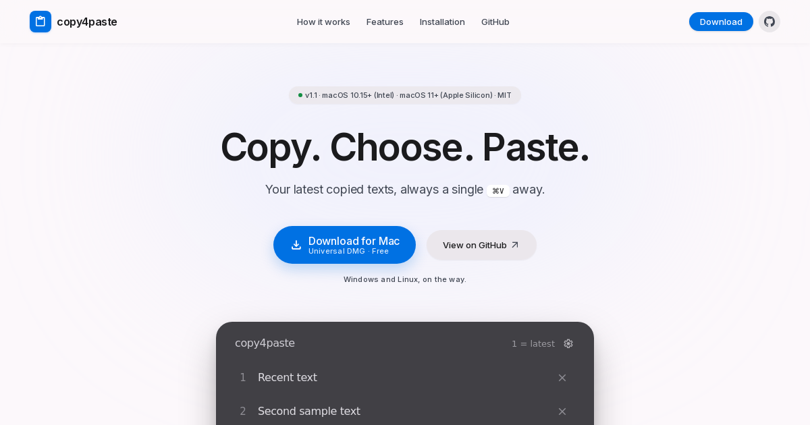

# copy4paste

**Copia. Elige. Pega.** Un portapapeles con historial para macOS: pulsa `⌘V` y elige entre tus
últimos textos con una tecla, sin abrir ventanas ni soltar el teclado.

[**Descargar para Mac**](https://github.com/KidiNoise/copy4paste/releases/latest/download/copy4paste-macOS-universal.dmg) ·
[Web del proyecto](https://kidinoise.github.io/copy4paste/) ·
[Licencia MIT](LICENSE)

[](https://kidinoise.github.io/copy4paste/)

Utilidad nativa de AppKit, sin Electron ni dependencias externas. Todo el historial vive en RAM.

## Qué hace

- `⌘C` guarda los últimos **4 textos** (ajustable de 1 a 30 en Ajustes).
- `⌘V`: si hay más de un texto, aparece un selector flotante; la copia **más reciente es siempre la 1**.
  - `1`–`9` pega esa copia.
  - `↑`/`↓` mueve el sombreado, `Intro` pega.
  - `Retroceso` borra la copia seleccionada **sin pegar**.
  - `×` a la derecha de cada fila borra esa fila con el ratón.
  - `Esc` cierra sin pegar.
- `⚙` en el selector (o `⌃⌥⌘P`) abre Ajustes: copias, skin, opacidad y salir.
- Si solo hay una copia, o el portapapeles contiene archivos o imágenes, `⌘V` se comporta como siempre.
- Sin icono en el Dock, sin demo al arrancar y sin historial en disco.
- Las acciones del selector trabajan sobre la instantánea visible: si el portapapeles cambia mientras
  está abierto, no se borra ni se pega la entrada equivocada.

## Requisitos

- **Intel**: macOS 10.15 Catalina o posterior.
- **Apple Silicon**: macOS 11 Big Sur o posterior.
- El DMG es **universal** (x86_64 + arm64).

## Instalación

1. Descarga el DMG y ábrelo.
2. Arrastra `copy4paste.app` a **Aplicaciones**.
3. Primer arranque: **clic derecho → Abrir** (la app está firmada *ad hoc*, no notarizada).
4. Ajustes del Sistema → Privacidad y seguridad → **Accesibilidad** → activa `copy4paste`.
5. Copia dos textos distintos y pulsa `⌘V`.

Si macOS insiste en bloquearla, revisa Ajustes del Sistema → Privacidad y seguridad → «Abrir igualmente».

> **Por qué avisa Gatekeeper:** no hay cuenta Apple Developer detrás de este proyecto, así que el
> binario no está notarizado. El aviso es de macOS, no un fallo de la app. El código es libre y
> compilable: puedes construirla tú mismo con los pasos de abajo.

El permiso de Accesibilidad está ligado a la firma *ad hoc*: cada recompilación exige volver a marcarlo
una vez.

## Compilar desde el código

Requiere Xcode Command Line Tools en macOS.

```bash
# Tests del historial
swiftc Core/HistoryStore.swift Tests/main.swift -o /tmp/copy4paste-history-test
/tmp/copy4paste-history-test

# App universal
SDK="$(xcrun --sdk macosx --show-sdk-path)"
mkdir -p dist/copy4paste.app/Contents/MacOS
cp Info.plist dist/copy4paste.app/Contents/Info.plist
for ARCH_TARGET in x86_64-apple-macosx10.15 arm64-apple-macosx11.0; do
  xcrun swiftc -swift-version 5 -O -target "$ARCH_TARGET" -sdk "$SDK" \
    -framework AppKit -framework ApplicationServices -framework CoreGraphics \
    Core/HistoryStore.swift Sources/main.swift -o "dist/copy4paste-${ARCH_TARGET%%-*}"
done
lipo -create -output dist/copy4paste.app/Contents/MacOS/copy4paste \
  dist/copy4paste-x86_64 dist/copy4paste-arm64
codesign --force --deep --sign - dist/copy4paste.app
```

El flujo de GitHub Actions (`.github/workflows/build-macos.yml`) hace exactamente esto en un runner
`macos-15-intel`: tests, compilación de las dos arquitecturas, `lipo`, comprobación de versiones mínimas,
pruebas de interfaz y de ejecución, DMG en HFS+ y verificación del DMG montado.

## Privacidad

- El historial vive en **RAM** durante la ejecución; se pierde al cerrar la app.
- Solo se guardan en `UserDefaults` las preferencias: número de copias, skin y opacidad.
- Se ignoran archivos, imágenes y tipos marcados como confidenciales o transitorios.
- **No hay red, ni telemetría, ni cuentas, ni nube.**
- Al manejar contraseñas conviene cerrar la utilidad: algunas aplicaciones no marcan bien los datos
  sensibles en el portapapeles.

## Estructura

```
Sources/main.swift          app AppKit (interfaz, atajo global, selector, ajustes)
Core/HistoryStore.swift     historial en memoria
Tests/main.swift            18 comprobaciones del historial
Info.plist                  bundle com.kidinoise.copy4paste
docs/                       web del proyecto (GitHub Pages)
```

## Estado

Versión **1.1**. Probada en macOS Catalina 10.15.7 (Intel) y compilada en CI para Intel + Apple Silicon.
Sin notarizar. Issues y propuestas: [GitHub Issues](https://github.com/KidiNoise/copy4paste/issues).

## Licencia

MIT — consulta [LICENSE](LICENSE).
