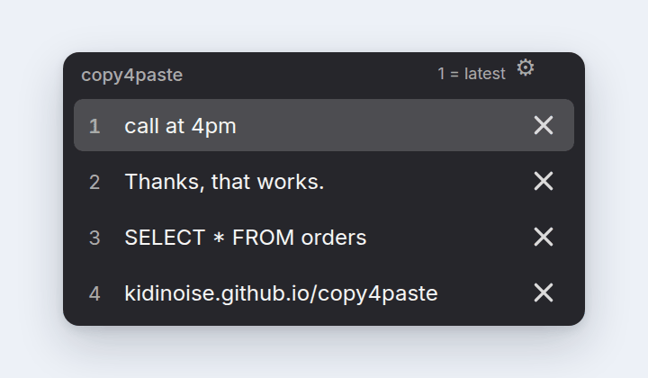
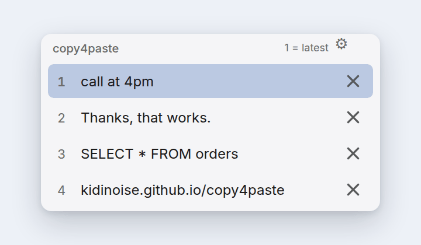
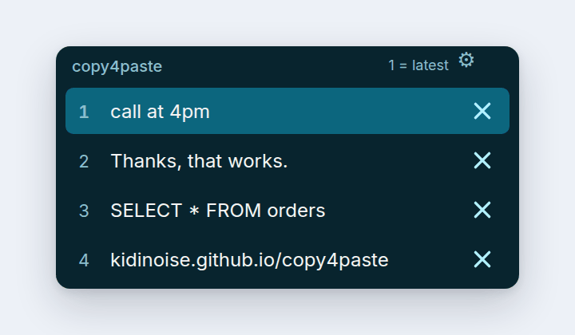
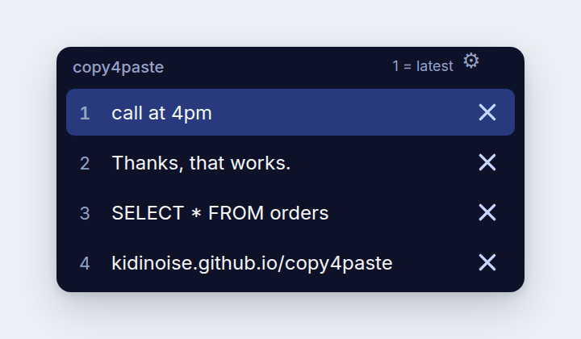
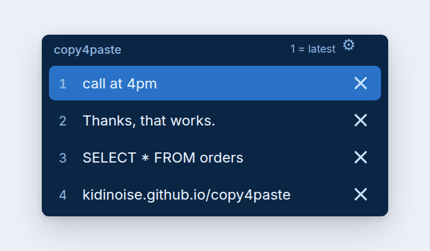
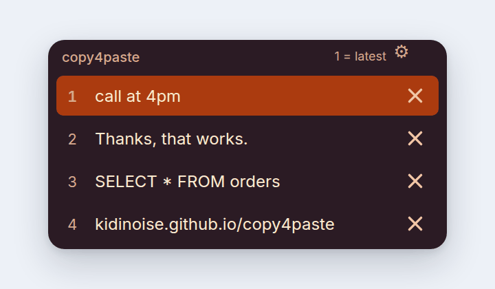

<p align="center">
  <a href="https://kidinoise.github.io/copy4paste/">
    
  </a>
</p>

<p align="center">
  <a href="https://github.com/KidiNoise/copy4paste/releases/latest"></a>
  
  
  
  
  
  <br>
  <a href="https://github.com/KidiNoise/copy4paste/actions/workflows/build-macos.yml"></a>
  <a href="https://github.com/KidiNoise/copy4paste/actions/workflows/build-windows.yml"></a>
  <a href="https://github.com/KidiNoise/copy4paste/actions/workflows/build-linux.yml"></a>
</p>

<p align="center">
  <b><a href="https://github.com/KidiNoise/copy4paste/releases/latest/download/copy4paste-macOS-universal.dmg">Download for Mac</a></b>
  &nbsp;·&nbsp;
  <b><a href="https://github.com/KidiNoise/copy4paste/releases/latest/download/copy4paste-windows-x64.zip">Windows</a></b>
  &nbsp;·&nbsp;
  <b><a href="https://github.com/KidiNoise/copy4paste/releases/latest/download/copy4paste-linux-x86_64.tar.gz">Linux</a></b>
  &nbsp;·&nbsp;
  <a href="https://kidinoise.github.io/copy4paste/">Project website</a>
  &nbsp;·&nbsp;
  <a href="#installation">How to install</a>
</p>

---

<!-- C4P GIF PREVIEW START -->
<p align="center">
  <a href="https://kidinoise.github.io/copy4paste/">
    
  </a>
</p>
<p align="center"><a href="https://kidinoise.github.io/copy4paste/">Watch the full 21-second demo and download Copy4Paste</a></p>
<!-- C4P GIF PREVIEW END -->

Copy several pieces of text and pick which one to paste with a single key. Press `⌘V` (or `Ctrl+V` on
Windows and Linux) and a small floating picker appears with your latest copies; hit `1`, `2`, `3`… and
keep working. Native on all three platforms, no Electron, no network, no history on disk.

> **Platforms:** macOS 10.15+ (Intel and Apple Silicon in one DMG) — **stable**; Windows 10 and 11
> (single `.exe`, no installer) and Linux x86_64 on top of GTK 3 — **beta**, see below. Same app, same
> four skins, same JSON skin format everywhere; the picker, the shortcuts and the settings behave the
> same on each.

### Windows and Linux are beta

They are published so they can be tried, not because they are finished. macOS has been in use since
1.1; Windows and Linux have not been used by real people yet. What is known today:

| | Status |
|---|---|
| Windows 10/11 | **Beta.** Automated tests cover the picker, the skins, the hook, a real paste into another application and the case where the hook cannot be installed. Not code-signed. |
| Linux, X11 | **Beta.** Same coverage on X11 under a real X server, including a check for a `Ctrl+V` already owned by another application. |
| Linux, Wayland | **Not supported.** Wayland gives an application no way to read the clipboard in the background and none to intercept keystrokes, so there is no history to show. The app stops at startup and says so. |

Betas are expected to change. Reports go to the
[issue tracker](https://github.com/KidiNoise/copy4paste/issues); the beta validation checklist lives in
[#6](https://github.com/KidiNoise/copy4paste/issues/6).

## Community skins

Copy4Paste ships with **four built-in skins** and imports any skin you download as a small `.json`
file. Same picker, your colours:

<table>
<tr>
    <td align="center" width="33%">
      
      <br><strong>Dark</strong> · <sub>Built-in</sub>
    </td>
    <td align="center" width="33%">
      
      <br><strong>Light</strong> · <sub>Built-in</sub>
    </td>
    <td align="center" width="33%">
      
      <br><strong>Cyan</strong> · <sub>Built-in</sub>
    </td>
</tr>
<tr>
    <td align="center" width="33%">
      
      <br><strong>Midnight</strong> · <sub>Built-in</sub>
    </td>
    <td align="center" width="33%">
      
      <br><strong>Ocean</strong> · <sub>JSON example</sub>
    </td>
    <td align="center" width="33%">
      
      <br><strong>Sunset</strong> · <sub>JSON example</sub>
    </td>
</tr>
</table>

**Built-in** — Dark, Light, Cyan and Midnight are always available and cannot be removed.
**JSON examples** — [Ocean](skins/examples/ocean.json) and [Sunset](skins/examples/sunset.json) are
community skins: download the file and import it.

### Use a skin

- **Built-in:** press `⌘V` (or `Ctrl+V`), click the gear, choose **Skin**, pick one. The panel changes
  as you pick.
- **Downloaded:** open [Ocean](skins/examples/ocean.json) or [Sunset](skins/examples/sunset.json),
  press **Download raw file**, then gear → **Import JSON skin…** and choose it. It applies immediately
  and stays in your list.

Imported skins are copied to `~/Library/Application Support/copy4paste/skins/` on macOS,
`%APPDATA%\copy4paste\skins` on Windows and `~/.config/copy4paste/skins/` on Linux. A skin made for
one platform works on the other two.

### Make your own — and share it

**Your palette belongs here.** Ocean and Sunset started as two files someone edited in a text
editor; a skin you design can join the gallery above, credited to you.

1. Copy [`template.json`](skins/template.json), rename it, change the five colours.
2. Import it with **Import JSON skin…** and check it with `⌘V` / `Ctrl+V`.
3. Add the file to [`skins/examples/`](skins/examples/) and open a Pull Request named after your skin.

- [Template](skins/template.json) — copy it, rename it, change the five colours.
- [Beginner guide](skins/README.md) — the format, every field, and how to test it. No programming
  needed: the file is plain text.
- [Send it as a Pull Request](skins/README.md#share-your-skin-pull-request) — add your file to
  `skins/examples/` and open a PR with the name of your skin.

> A skin is **data only**: five colours, a corner radius and an optional font. Nothing in the file is
> executed, nothing is uploaded, and the app makes no network requests. There is no in-app store —
> you download the JSON yourself and import it. The previews above are drawn from the palette and
> geometry in the macOS source; they are illustrations, not screenshots.

## Installation

### macOS

1. Download the **DMG** and open it.
2. Drag `copy4paste.app` to **Applications**.
3. Open the app: **right-click → Open** → **Open** in the dialog.
4. System Settings → Privacy & Security → **Accessibility** → enable `copy4paste`.
5. Copy two different pieces of text and press `⌘V`.

### Windows 10 and 11

1. Download `copy4paste-windows-x64.zip` and unpack it anywhere: the `.exe` is the whole app.
2. Run `copy4paste.exe`. SmartScreen may warn once because the build is not code-signed: **More info
   → Run anyway**. If you prefer, right-click the file → Properties → **Unblock** before running it.
3. It waits in the notification area (next to the clock). Right-click the icon for the picker,
   Settings and Quit; `Ctrl+Alt+P` opens Settings from anywhere.
4. Copy two different pieces of text and press `Ctrl+V`.

To start it with Windows, put a shortcut to the `.exe` in `shell:startup` (press `Win+R`, type
`shell:startup`).

### Linux

1. Download `copy4paste-linux-x86_64.tar.gz` and unpack it, or install `copy4paste_x86_64.deb` with
   your package manager.
2. From the unpacked folder run `./install.sh`: it copies the binary to `~/.local/bin`, adds the menu
   entry and the icon, and needs no root.
3. Run `copy4paste` (or pick it from the applications menu) and copy two different pieces of text.
4. On **X11**, `Ctrl+V` opens the picker from any app. On **Wayland** the app does not run at all: a
   compositor gives an application no way to read the clipboard in the background, so there would be
   no history to pick from. It stops with a message saying so. Check with `echo $XDG_SESSION_TYPE`
   and log in with an X11 session.
5. One instance owns the history: `copy4paste --select` and `copy4paste --settings` reach it over a
   socket in `$XDG_RUNTIME_DIR`, so a keyboard shortcut of your desktop opens the same picker.

Requires GTK 3, libX11 and libXtst — present on every desktop distribution; nothing else is bundled.

### The builds are not notarized or code-signed, and here is what you will run into

This matters, so it is said plainly: **the macOS binary is signed *ad hoc*, and the Windows one is not
signed at all.** Notarization and a code-signing certificate cost money every year and this project
does not have them. In practice the systems distrust the file the first time, even though the code is
open and anyone can build it.

**macOS** depends on your version:

- **macOS 10.15 to 14**: right-click the app → **Open** → **Open**. First launch only.
- **macOS 15 or later**: «right-click → Open» may no longer offer that button. Then:
  1. Try to open the app and wait until macOS blocks it.
  2. System Settings → **Privacy & Security**.
  3. Scroll down to the notice about `copy4paste` → **Open Anyway** → Touch ID or password.
- **If it still will not start**, open Terminal and clear the quarantine flag on the downloaded file:

  ```bash
  xattr -dr com.apple.quarantine /Applications/copy4paste.app
  open /Applications/copy4paste.app
  ```

  This is the same mechanism every internet-downloaded app goes through; it does not disable
  Gatekeeper for the rest of the system.

After the first launch the warning does not come back. The **Accessibility** permission does have to
be granted again whenever the app is rebuilt, because it is tied to the signature.

**Windows**: SmartScreen shows «Windows protected your PC» once. **More info → Run anyway**, or
unblock the file in its Properties. There is no installer and no admin prompt.

**Linux**: no warning; the tarball is a plain binary and the `.deb` installs like any other package.

If you ever want the warnings gone for everyone, the macOS path is already wired: an Apple Developer
account, a *Developer ID Application* certificate and five repository secrets. The workflow
`.github/workflows/build-macos.yml` signs with Hardened Runtime, notarizes and verifies on its own,
with no code changes. See [NOTARIZATION.md](NOTARIZATION.md).

## What it does

- Copy keeps the last **4 texts** (adjustable from 1 to 30).
- Paste (`⌘V` on macOS, `Ctrl+V` on Windows and Linux): picker with the **most recent copy on top**.
  - `1`–`9` pastes that copy · `↑`/`↓` + `Enter` navigates · `Backspace` deletes without pasting ·
    `Esc` cancels.
  - The `×` on the right of each row deletes that entry with the mouse.
- `⚙` (or `Ctrl+Alt+P`; `⌃⌥⌘P` on macOS) opens Settings: number of copies, **skin** (Dark, Light, Cyan,
  Midnight or any imported community skin), **opacity** and quit.
- **Community skins**: download a `.json` skin, import it from Settings and it applies instantly.
  See [skins/](skins/README.md).
- With a single copy, or when the clipboard holds files or images, the paste key behaves as usual.
- No Dock icon, no window at launch, no history on disk. On Windows it lives in the notification area;
  on Linux it runs with a menu entry and no window.
- `copy4paste --select`, `--settings` and `--status` (Linux) and the tray menu (Windows) act on the
  running instance, never on a second, empty one.

## Privacy

The history lives **in RAM** and disappears when the app quits. Only preferences are stored (number of
copies, skin, opacity). Imported skins are plain JSON files copied to the folder listed above; they
contain no code. No network, no telemetry, no accounts, no cloud. It is worth quitting it while
handling passwords: some apps do not flag sensitive data on the clipboard properly.

## Downloads

| File | What it is |
|---|---|
| `copy4paste-macOS-universal.dmg` | Installer. Intel 10.15+ and Apple Silicon 11+ in a single binary. |
| `copy4paste-macOS-universal.zip` | The same app zipped, in case the DMG gives you trouble. |
| `copy4paste-windows-x64.zip` | **Beta.** The Windows app: one `.exe`, no installer, no admin rights. |
| `copy4paste-linux-x86_64.tar.gz` | **Beta.** Linux build with `install.sh`, menu entry and icon (X11). |
| `copy4paste_x86_64.deb` | **Beta.** The same Linux build as a Debian/Ubuntu package (X11). |
| `SHA256SUMS`, `SHA256SUMS-linux`, `SHA256SUMS-windows` | Checksums to verify the download arrived intact. |

## Build

Every platform lives in its own folder with its own workflow. Nothing is shared between them except
the C core in `shared/` that Windows and Linux use for skins, history and preferences.

**macOS** — requires Xcode Command Line Tools:

```bash
swiftc -swift-version 5 macos/Core/HistoryStore.swift macos/Core/SkinTheme.swift macos/Tests/main.swift -o /tmp/copy4paste-core-test
/tmp/copy4paste-core-test
```

The app and the DMG are built by GitHub Actions on a macOS runner
(`.github/workflows/build-macos.yml`), from the code in `macos/`: tests, a **universal** binary
(Intel 10.15 + Apple Silicon 11.0), interface test, runtime test, signing, HFS+ DMG and a check of the
mounted DMG.

**Windows** — cross-compiled with mingw-w64, no Visual Studio needed:

```bash
./windows/build.sh build
# core tests, then the real hook and clipboard through SendInput:
cc -std=c11 -O2 -Wall -Wextra -Werror shared/*.c -o build/core-test.exe   # any C11 compiler
./windows/test-windows.ps1 -Exe build\copy4paste.exe                     # on Windows
```

`.github/workflows/build-windows.yml` builds and tests on a real Windows runner: the low-level
keyboard hook, `Ctrl+V`, the digit selection, the skins, the settings window, a **real paste into a
separate test application** (`windows/tests/paste_target.c`, its own window and edit control) and the
case where the keyboard hook cannot be installed. Every run uses a throwaway `%APPDATA%`, so a personal
configuration is never touched. From Linux a subset can be checked through Wine with
`windows/test-windows.sh`.

**Linux** — needs `libgtk-3-dev`, `libxtst-dev`, `pkg-config` and a C compiler:

```bash
./linux/build.sh build
xvfb-run -a --server-args="-screen 0 1440x900x24" sh linux/test-linux.sh build/copy4paste
```

`linux/build.sh` produces `build/copy4paste`; `linux/package.sh` makes the tarball and the `.deb`.
Next to the end-to-end test there are `linux/test-ipc.sh` (one instance owns the history and
`--select` reaches it), `linux/test-x11-conflict.sh` (another application already owns `Ctrl+V`) and
`linux/test-wayland.sh` (a real headless Weston session, to prove the app refuses instead of breaking).
The core tests (`shared/tests.c`) run on every platform: colours, skin parsing and its error messages,
imports, the history rules and the preferences file.

Pushing a `v*` tag makes the three release workflows publish their files into the same Release:
`release-macos.yml`, `release-windows.yml` and `release-linux.yml`.

## Layout

```
macos/     AppKit app (Sources, Core, Tests, Info.plist, icon)
windows/   Win32 app (main.c, resources, build and test scripts)
linux/     GTK 3 app (main.c, desktop entry, install and package scripts)
shared/    C core used by Windows and Linux: skins, history, preferences, tests
skins/     community skins: template, examples and guide
docs/      project website
.github/   per-platform build and release workflows
```

Each platform keeps its own code: the picker is drawn by the system toolkit of each platform (AppKit,
GDI, Cairo) with the same geometry, and the shared C core guarantees the four skins and the imported
ones look and parse the same everywhere.

Website notes in [`docs/README.md`](docs/README.md).

## License

MIT — see [LICENSE](LICENSE).
