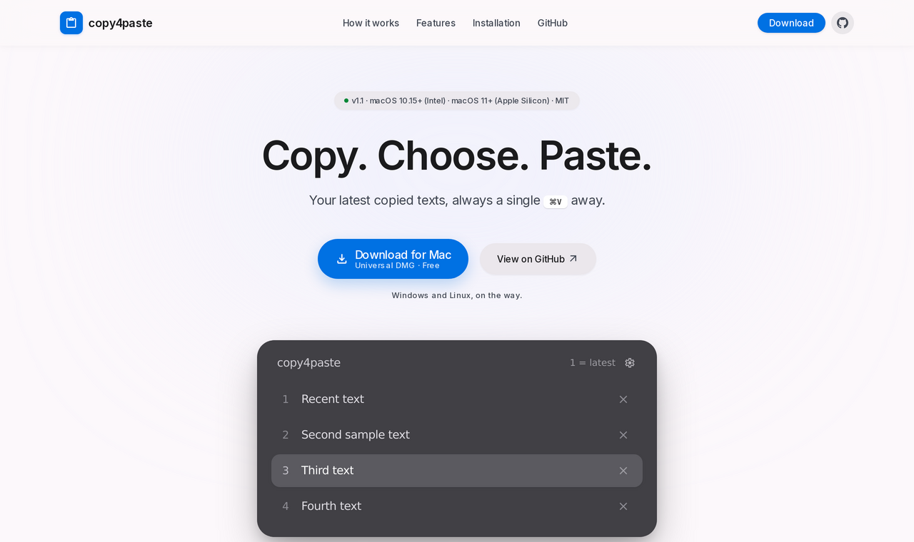
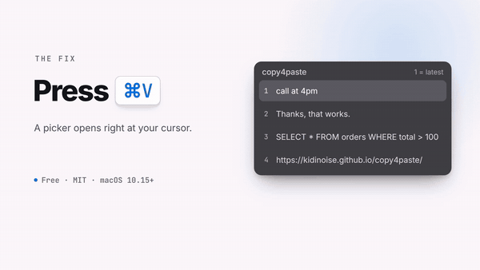

<p align="center">
  <a href="https://kidinoise.github.io/copy4paste/">
    
  </a>
</p>

<p align="center">
  <a href="https://github.com/KidiNoise/copy4paste/releases/latest"></a>
  
  
  
  <a href="https://github.com/KidiNoise/copy4paste/actions/workflows/build-macos.yml"></a>
</p>

<p align="center">
  <b><a href="https://github.com/KidiNoise/copy4paste/releases/latest/download/copy4paste-macOS-universal.dmg">Download for Mac</a></b>
  &nbsp;·&nbsp;
  <a href="https://kidinoise.github.io/copy4paste/">Project website</a>
  &nbsp;·&nbsp;
  <a href="#installation">How to install</a>
</p>

---

<!-- C4P GIF PREVIEW START -->
<p align="center">
  <a href="https://kidinoise.github.io/copy4paste/">
    
  </a>
</p>
<p align="center"><a href="https://kidinoise.github.io/copy4paste/">Watch the full 21-second demo and download Copy4Paste</a></p>
<!-- C4P GIF PREVIEW END -->

Copy several pieces of text and pick which one to paste with a single key. Press `⌘V` and a small
floating picker appears with your latest copies; hit `1`, `2`, `3`… and keep working. Native macOS,
no Electron, no network, no history on disk.

> **Platforms:** macOS available today (Intel and Apple Silicon in one DMG). **Windows** and **Linux**
> are in development; they will ship as separate downloads and will not change anything that already
> works on Mac.

## Installation

1. Download the **DMG** and open it.
2. Drag `copy4paste.app` to **Applications**.
3. Open the app: **right-click → Open** → **Open** in the dialog.
4. System Settings → Privacy & Security → **Accessibility** → enable `copy4paste`.
5. Copy two different pieces of text and press `⌘V`.

### The app is not notarized by Apple, and here is what you will run into

This matters, so it is said plainly: **the binary is signed *ad hoc*, not notarized.** Notarization
requires an Apple Developer Program account (99 USD a year) that this project does not have. In
practice macOS distrusts the file the first time, even though the code is open and anyone can build it.

What happens depends on your version:

- **macOS 10.15 to 14**: right-click the app → **Open** → **Open**. First launch only.
- **macOS 15 or later**: «right-click → Open» may no longer offer that button. Then:
  1. Try to open the app and wait until macOS blocks it.
  2. System Settings → **Privacy & Security**.
  3. Scroll down to the notice about `copy4paste` → **Open Anyway** → Touch ID or password.
- **If it still will not start**, open Terminal and clear the quarantine flag on the downloaded file:

  ```bash
  xattr -dr com.apple.quarantine /Applications/copy4paste.app
  open /Applications/copy4paste.app
  ```

  This is the same mechanism every internet-downloaded app goes through; it does not disable
  Gatekeeper for the rest of the system.

After the first launch the warning does not come back. The **Accessibility** permission does have to
be granted again whenever the app is rebuilt, because it is tied to the signature.

If you ever want the warning gone for everyone, the path is already wired: an Apple Developer account,
a *Developer ID Application* certificate and five repository secrets. The workflow
`.github/workflows/build-macos.yml` signs with Hardened Runtime, notarizes and verifies on its own,
with no code changes. See [NOTARIZATION.md](NOTARIZATION.md).

## What it does

- `⌘C` keeps the last **4 texts** (adjustable from 1 to 30).
- `⌘V`: picker with the **most recent copy on top**.
  - `1`–`9` pastes that copy · `↑`/`↓` + `Enter` navigates · `Backspace` deletes without pasting ·
    `Esc` cancels.
  - The `×` on the right of each row deletes that entry with the mouse.
- `⚙` (or `⌃⌥⌘P`) opens Settings: number of copies, **skin** (Dark, Light, Cyan,
  Midnight or any imported community skin), **opacity** and quit.
- **Community skins**: download a `.json` skin, import it from Settings and it applies
  instantly. See [skins/](skins/README.md).
- With a single copy, or when the clipboard holds files or images, `⌘V` behaves as usual.
- No Dock icon, no window at launch, no history on disk.

## Privacy

The history lives **in RAM** and disappears when the app quits. Only preferences are stored (number of
copies, skin, opacity). Imported skins are plain JSON files copied to
`~/Library/Application Support/copy4paste/skins/`; they contain no code. No network, no telemetry, no
accounts, no cloud. It is worth quitting it while handling passwords: some apps do not flag sensitive
data on the clipboard properly.

## Downloads

| File | What it is |
|---|---|
| `copy4paste-macOS-universal.dmg` | Installer. Intel 10.15+ and Apple Silicon 11+ in a single binary. |
| `copy4paste-macOS-universal.zip` | The same app zipped, in case the DMG gives you trouble. |
| `SHA256SUMS` | Checksums to verify the download arrived intact. |

## Build

Requires Xcode Command Line Tools on macOS.

```bash
swiftc -swift-version 5 macos/Core/HistoryStore.swift macos/Core/SkinTheme.swift macos/Tests/main.swift -o /tmp/copy4paste-core-test
/tmp/copy4paste-core-test
```

The app and the DMG are built by GitHub Actions on a macOS runner
(`.github/workflows/build-macos.yml`), from the code in `macos/`: tests, a **universal** binary
(Intel 10.15 + Apple Silicon 11.0), interface test, runtime test, signing, HFS+ DMG and a check of the
mounted DMG. Pushing a `v*` tag makes `release-macos.yml` publish the Release with the DMG, the ZIP and
`SHA256SUMS`.

## Layout

```
macos/     AppKit app (Sources, Core, Tests, Info.plist, icon)
skins/     community skins: template, examples and guide
docs/      project website
.github/   macOS build and release workflows
```

Each platform lives in its own folder with its own build workflow. When Windows and Linux are ready
they will be added as `windows/` and `linux/`, with their `.github/workflows/build-<platform>.yml`,
and will publish their archive in the same Release. Nothing that already works on macOS is touched:
they are new files next to it.

Website notes in [`docs/README.md`](docs/README.md).

## License

MIT — see [LICENSE](LICENSE).
